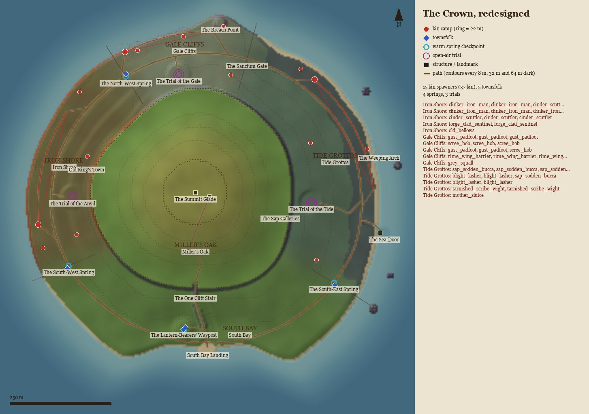
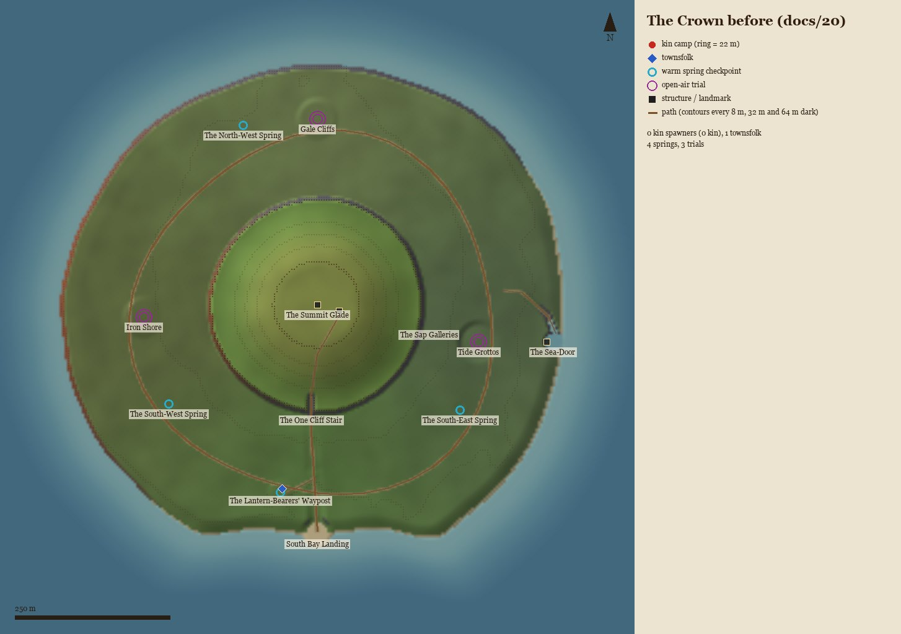
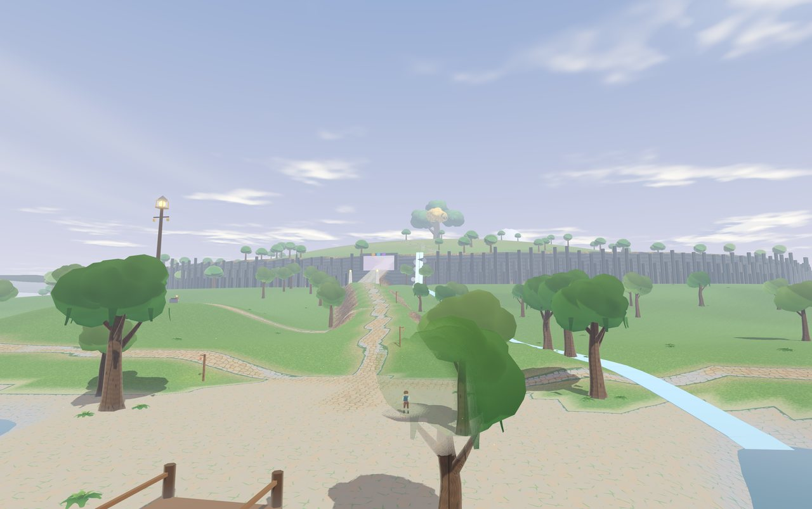
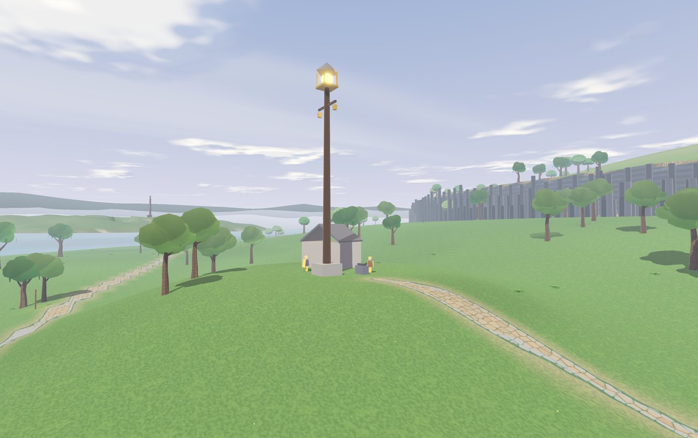
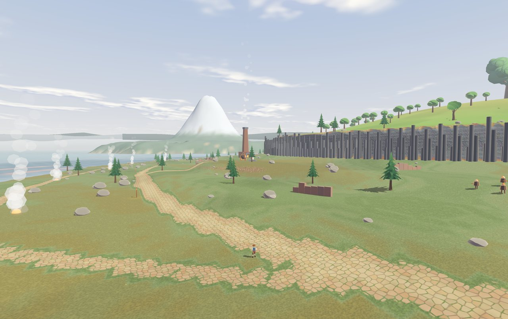
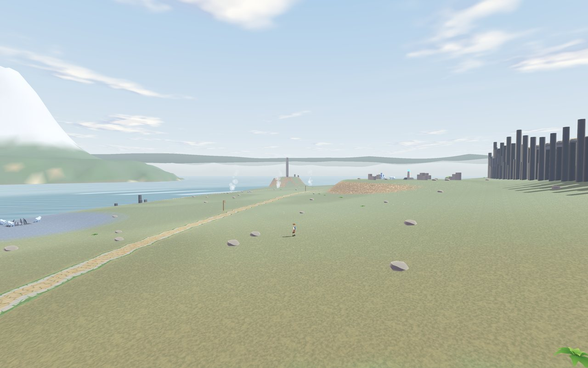
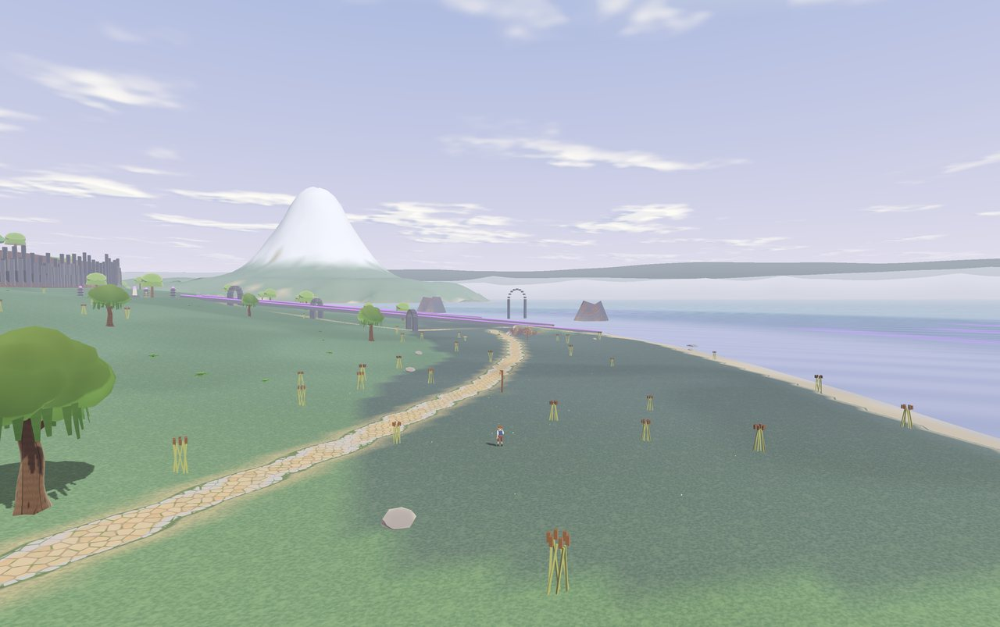
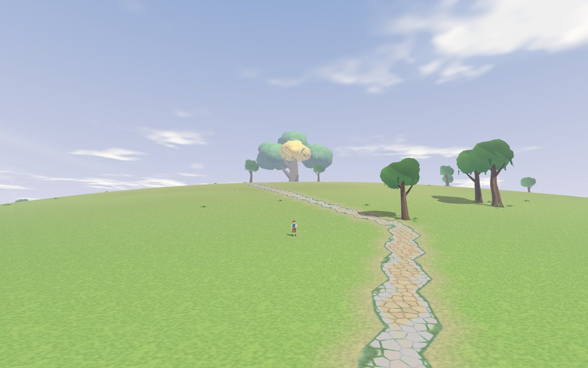

# 23 · The Crown, redesigned: four shores round Miller's Oak

> **Source:** `Everwood — The Crown Island-selection.pdf` (the Crown's council ruling and the Master Crown v1 map, the same content as `docs/atlas_sources/03_design_and_game_theory_loop_musk_razor.pdf` and `04_master_crown_heart_crag.pdf`), read with MMO zone-design and game-theory practice.
> **Rename:** the World-Tree at the Crown's centre is now **Miller's Oak** on every screen. Class names, ids and save keys keep the old name (`WorldTree`, `WORLD_TREE_AT`), as the Lens pass did.
> **Scope:** The Crown only (Zone 5). The other four isles, the seams, the trials' rules, the Harmonic Bell and the Ebb are unchanged.

---

## 1. What the first build got wrong

The first build (docs/20 Part III) placed every area at the brief's coordinates. Walking it as a player showed six problems:

| # | Problem | Why it matters |
| :-- | :-- | :-- |
| 1 | The Ring Path ran **straight through all three trial arenas**. | Anyone walking the loop set off a capstone fight. A boss should sit off the road, chosen, not tripped over. |
| 2 | Two of the three warm springs sat **off the Ring Path**. | A checkpoint you can miss is no checkpoint. A split party had no clear place to meet. |
| 3 | **No kin outside the trials, one townsperson.** | Three level 15-18 shores with nothing to fight or learn before the capstone. The trial was the first time you met its lesson. |
| 4 | **Every shore looked the same:** one round terrace, one round cliff band. | The PDF says each shore takes its rock and exposure from the isle it faces. Players couldn't tell where they were. |
| 5 | **Landmarks under 3 m tall** (ruin walls, vents). | Nothing to steer by between the springs except the tree. |
| 6 | **The Crown borrowed the Cairnsman's boss music.** | The last island played another zone's fight score. |

---

## 2. The rules the redesign follows

Each rule is a check in `tools/test_crown_zones.gd`, so it stays true.

### MMO zone design

1. **Hub, spokes and a loop.** The Waypost is the hub; the Ring Path is a loop with no dead ends. Each shore's optional "shore track" leaves the loop and comes back to it.
2. **Bosses off the road.** Each trial sits between the Ring Path and the cliff band, the cliff at its back like a stage, on a short spur. The road passes every arena by 23 m or more.
3. **Checkpoints on the road, at the borders.** Each spring is on the Ring Path where two shores meet. No trial is more than about 350 m (a minute's walk) from a spring.
4. **A tall landmark per zone, seen from both its springs.** The Old King's Kiln (24 m, steaming), the Sanctum Arch (16 m on the Breach Point), the Weeping Arch (a 20 m sea arch) and the Waypost's lantern-mast (20 m). Miller's Oak's crown is in sight from every step of the Ring Path, every trial and the Landing.
5. **A safe hub and a safe road.** No kin in South Bay or on the dome. Every camp stands back from every road by more than its kin's waking reach plus 6 m, at least 60 m from any spring and 90 m from the Waypost and the Landing. Travellers fight only when they choose to.
6. **Teach before you test.** Each shore's field kin show the trial's lesson in small: Iron Shore's Clinker Iron-Men shrug off chip blows until their poise breaks; the Gale Cliffs' Gust-Padfoots dash 7 m in straight lines; the Tide Grottos' Blight-Lashers stand rooted at the sluices.
7. **Difficulty grows away from the hub:** no kin at the Landing, camps along each shore, an elite pair at each landmark, a named rare on each shore track, the trial at the end of the spur.
8. **Music marks the zones,** crossfading at the springs.

### Game theory

1. **No dominant order.** From the Landing, the west and east trials are 625 m and 701 m away (12% apart). The north trial is the far point either way round. All six orders are worth taking.
2. **Focal points.** The springs are named, lit and on the road, so a split party regroups there without talking it over (Schelling points). Miller's Oak is the island's one global focal point.
3. **Split, then converge.** Three trials on three shores, none in another's way, so a party of 5 online can split, and each part makes progress alone. The Harmonic Bell then needs everyone at once: a pure coordination game nobody can carry or skip (unchanged from the PDF).
4. **Nothing to compete over.** Party XP is shared and camps regrow in 60-120 s, so no one steals a kill or races for a tag.
5. **Risk you choose.** Elite pairs and rares stand off the road with slower regrowth (4-6 min, 12-18 min). Taking them on is optional and visible, never forced.
6. **Common knowledge.** The Warden and each scout say what their shore needs, and signs at each spring name the shores either side. Everyone knows the same facts before choosing.

---

## 3. The four zones and Miller's Oak

Bearings run clockwise from north round the island's middle. The four shores are wedges split at the springs and the Sanctum Gate. The dome inside the +32 m cliff band is Miller's Oak's own zone.

| Zone | Bearings | Lv | Ground | Roads | Landmark | Townsfolk | Kin | Music |
| :-- | :-- | :-- | :-- | :-- | :-- | :-- | :-- | :-- |
| **South Bay** | 121°–247° | 15 | The gentle bay and the summit stream's gully, the stream falling down the band beside the stair. | The Landing crossroads, the gully road, the One Cliff Stair. | The Waypost's 20 m lantern-mast. | Tamsin Brightwick (Quartermaster), Wenna Lampwright (Warden). | None: the hub is safe. | *The Lantern-Bearers' Landing*, D Ionian 3/4. |
| **Iron Shore** | 247°–328° | 15–18 | Ironstone shelves stepping down to cliffs in 3 m treads. Steam vents by the sea. | Ring Path, the Anvil's spur, the vents track. | The Old King's Kiln in Old King's Town. | Pell Kilnworth at the South-West Spring. | 3 camps, 2 Forge-Clad Sentinels at the Kiln, Old Bellows on the vents track. | *Old King's Anvil*, A Mixolydian 4/4. |
| **Gale Cliffs** | 328°–15° | 15–18 | The highest shore, bare, ending in sheer sea-cliffs. The Breach Point juts north. | Ring Path, the Gale's spur, the cliff-top track. | The Sanctum Arch on the Breach Point. | Sorrel Windhame at the North-West Spring. | 3 camps, 3 Rime-Wing Harriers at the arch, the Grey Squall on the cliff-top. | *Breach Wind*, E Dorian 6/8. |
| **Tide Grottos** | 15°–121° | 15–18 | A low, worn shelf with reeds and willows. Four sea stacks offshore. The Sea-Door's cove. | Ring Path, the Tide's winding spur under grotto arches, the stair to the Sea-Door. | The Weeping Arch, stained violet by the sap. | Ione Saltmarsh at the South-East Spring. | 3 camps, 2 Tarnished Scribe-Wights at the arch, Mother Sluice on the shelf. | *The Weeping Sluices*, B Aeolian 3/4. |
| **Miller's Oak** | inside the band | 18–19 | A meadow dome rising from +32 m to the +65 m Summit Glade. | The summit walk, the oak ahead the whole way. | Miller's Oak, the Harmonic Bell, the old sap-taps in its roots. | None. | None: wild and sacred. | *Miller's Oak*, G Lydian 3/4. |
| The Sap Galleries | underground | 20 | The tunnel from the Sea-Door to the Heart. | — | — | — | — (the True Raid comes next) | The Tide's suite. |

### Numbers

| | |
| :-- | :-- |
| Island | about 900 m across in its 1,024 m grid; coast at 446 m (the bay at 362 m, the Breach Point to 480 m) |
| Cliff band | +32 m, 250 m from the dome's centre (wandering ±14 m), sheer all round except the One Cliff Stair (18 → 32.5 m at 17°) |
| Ring Path | 2.3 km round, about 8 minutes' walk, 1.4–14.5 m up (the PDF's 0–14 m) |
| Springs | South-West 9 m, North-West 12 m, South-East 5 m, each on the road |
| Trials | Anvil 16 m, Gale 20 m, Tide 14 m (a raised dais in the grottos), each 24 m across |
| Townsfolk | 5 (the PDF's "NPC states: low"; no town) |
| Kin | 15 spawners, 37 kin, plus the three trials' own |

---

## 4. Townsfolk

Five people, all at focal points. Each says three things, so every player starts with the same facts.

| Who | Where | What they say |
| :-- | :-- | :-- |
| **Wenna Lampwright**, Warden of the Waypost | the Waypost | Take any shore first. Split up if you like; each spring will stand you back up. When three boughs bloom, climb the stair and pull the bell together. |
| **Tamsin Brightwick**, Waypost Quartermaster | the Waypost | Arms, Ring-Coats and repairs at the anvil (unchanged). |
| **Pell Kilnworth**, Scout of Iron Shore | South-West Spring | Break the Colossus's poise first. The Clinker Iron-Men teach the same lesson. Old Bellows walks the vents. |
| **Sorrel Windhame**, Scout of the Gale Cliffs | North-West Spring | Get behind a wall when the gale gathers. The Gust-Padfoots dash in straight lines. The Grey Squall runs the cliff-top. |
| **Ione Saltmarsh**, Scout of the Tide Grottos | South-East Spring | Cleanse the three Sap-Siphons. Stand in a Sanctuary and mind the wights' bolts. Mother Sluice wallows by the sea. |

The PDF merged the Warden's house into the Waypost. The Warden now lives there.

---

## 5. Kin and bosses

A new family, **The Crown's Shore-Kin** (Lv 15-17), sits between the outer isles' elites and the trials' guards. They are data only (`Bestiary._add_crown_shore_kin()`), with no new systems.

| Shore | Kin | Body | HP · poise | The lesson |
| :-- | :-- | :-- | :-- | :-- |
| Iron Shore | **Clinker Iron-Man** | humanoid | 420 · 80 | 55% of every blow glances off until its poise breaks; then it takes 3x. |
| Iron Shore | **Cinder-Scuttler Hob** | scuttler | 200 · 30 | Fast swarmer. |
| Iron Shore | **Old Bellows** (rare) | hulk | 2,400 · 140 | The Anvil-Warden's lesson at full size: 70% glances off, then 5x when down. Stomps. |
| Gale Cliffs | **Gust-Padfoot** | wolf | 340 · 40 | A 7 m straight dash to step aside from. |
| Gale Cliffs | **Scree-Hob** | scuttler | 190 · 28 | Darting. |
| Gale Cliffs | **The Grey Squall** (rare) | wolf | 1,800 · 90 | A 10 m charge with a 1.3 s recovery: the window to answer in. |
| Tide Grottos | **Sap-Sodden Bucca** | toad | 380 · 40 | Wallower. |
| Tide Grottos | **Blight-Lasher Hob** | vine | 340 · 70 | Rooted at the sluices, bark armour, 3.6 m reach. |
| Tide Grottos | **Mother Sluice** (rare) | shambler | 2,200 · 120 | A wide 3 m puff. |

Each blow carries its shore's Sign (Iron-Root, Rime-Gale, Star-Tide). Beaten, they resolve as kin of the First-Quiet: Iron-Men sink to sleep as stewards, hobs and padfoots fly off as sea-swallows, the Tide's kin are lulled into cairns.

**Placement per shore:** three camps (respawn 60-120 s; the first has a Hush-Crack), one elite pair at the landmark (the trial's own guards: Forge-Clad Sentinels, Rime-Wing Harriers, Tarnished Scribe-Wights; 4-6 min) and one rare walking the shore track (12-18 min). The **bosses** stay as the PDF has them: the Anvil-Warden Colossus, Storm-Caller Vaelen and the Siphon-Prelate in the trials, and the Heart's True Raid under the oak (not built yet). There is no boss on the dome: the climax is the bell.

---

## 6. Landmarks and dressing

- **The Waypost's lantern-mast:** a stone footing, a 20 m mast, an open brass lantern and two hanging yard-lanterns. It is seen from both southern springs.
- **The summit stream's fall:** a ribbon of water down the band beside the stair, its pool and spray, and the stream running down the gully to the bay (the PDF's "south bay: the summit stream's gully").
- **The One Cliff Stair:** two lantern pillars at its foot.
- **The Old King's Kiln:** a 24 m ironstone chimney breathing steam over Old King's Town's street walls. Five steam vents line the sea.
- **The Sanctum Arch:** a 16 m broken arch on the Breach Point, framing The Breach. The Sanctum Gate is a ruined gateway across the Ring Path where the Gale Cliffs meet the Tide Grottos.
- **The Weeping Arch:** a 20 m sea arch at the waterline. One sluice runs to it and stains its landward pier violet. Grotto arches span the Tide's spur. Glints line the waterline, and four sea stacks stand offshore.
- **The old sap-taps** are still driven into Miller's Oak's root-flare. They are the PDF's "ruins explain the blight", told without a word.

---

## 7. Music

> **Now (docs/16 §7, 2026-11-06):** The Crown plays the **Crown Island Audio Mosaic** all over the isle, Clay's choice over these suites: twelve four-bar phrases in G (D major's relative key, so the same sharps) walking six moods, leaning wild on the three outer shores, to Wonder on high ground and to Curiosity and Anxiousness in the galleries. The five suites below stay registered and baked, `music_at()` still maps them, and naming one on The Crown's `CalderaAtlas` entry instead of `crown_island` brings them back.

**One key signature, five modes.** Every Crown suite uses only the notes of D major, so a crossfade at a spring never clashes. Each one states **Miller's Oak's hymn** in its own mode: the fifth below, the tonic, a step up to the third and back (5 1 2 3 2 1 5). The island sounds like one place with five moods.

| Profile | Title | Mode · meter · tempo | Voices |
| :-- | :-- | :-- | :-- |
| `crown_south_bay` | The Lantern-Bearers' Landing | D Ionian · 3/4 · 96 | A plucked weave; the hymn on the accordion, then the violin over a bassoon line. |
| `crown_iron_shore` | Old King's Anvil | A Mixolydian · 4/4 · 92 | The dulcimer march; an anvil bell every other bar, cello stabs; the hymn on the English horn, then the cello. |
| `crown_gale_cliffs` | Breach Wind | E Dorian · 6/8 · 104 | A rolling guitar; the hymn skirled on a tin whistle, then the flute; harp harmonics. |
| `crown_tide_grottos` | The Weeping Sluices | B Aeolian · 3/4 · 84 | A sparse harp, celesta glints, a tremolo cello; the hymn low on the English horn, then the oboe. |
| `crown_millers_oak` | Miller's Oak | G Lydian · 3/4 · 88 | Harp, carillon and a held bassoon; the hymn on the oboe with its Lydian lift, then the solo violin high over the accordion. |

Each has the four usual stems (folk base, lead, discord, skirmish), so fights layer in as they do elsewhere. `tools/build_audio_stems.py --only crown_…` bakes them. Listening copies are in `tools/audio_previews/` (git-ignored).

The level asks `CrownHeartCragBuilder.music_at()` for the suite. Within 6° of a shore's edge (or 8 m of the band), the tune already playing holds, so a party standing at a spring doesn't flip back and forth. The skies follow the same zones: Iron Shore wears Quarry-Wick's, the Gale Cliffs Gull-Wick-Haven's, the Tide Grottos and the galleries Nine-Stones-Crossing's.

---

## 8. Build notes (2026-11-06)

**Files.** `src/world/caldera/islands/crown_heart_crag_builder.gd` (rewritten: zones, ground, roads, landmarks, townsfolk, kin, `zone_at`, `music_at`, `place_name_at`, `roads`), `src/actors/bestiary.gd` and `src/resources/mob_variant_resource.gd` (the Shore-Kin family), `src/core/audio_catalog.gd` and `tools/build_audio_stems.py` (the five suites), `assets/audio/music/crown_*` (the baked stems), `src/levels/caldera_archipelago_world.gd` (music and skies by zone), `src/ui/cartography_baker.gd` (quest markers point at the trials), and display-only renames to Miller's Oak.

**Checks.** `tools/test_crown_zones.gd` (8 checks) runs inside `tools/test_caldera_isles.gd` while The Crown is live. It covers the zones, the roads, the balance, the sightlines, the kin, the townsfolk and the music, and watches Old Bellows walk its track. The Caldera run is 51 checks; the smoke test is 742.

### Deliberate differences (calls for the Creative Director)

1. **"Miller's Oak" is the World-Tree's new name.** No document in the repo or Drive defines it, so the build reads the request as renaming the tree at the centre. If you meant the island or something else, it's a display-string change.
2. **The springs moved down onto the road.** The first build held them at 8-18 m; the PDF holds the Ring Path to 0-14 m. They now sit at 5-12 m on the path, and the old check follows the PDF.
3. **The dome is bigger** (band at 250 m, not 172 m). This is closer to the PDF's proportions and gives the Tolkien climb a real final ascent, about 230 m of meadow with the oak ahead. Its centre moved to (-30, -36), north-west of the middle as on the PDF. The bell, tree and Heart moved with it.
4. **Trials moved off the Ring Path,** between the road and the band as the PDF draws them. The Tide's is deepest, about 110 m up a winding spur, so the east is the longer way round (12% more).
5. **Field kin are new.** The PDF lists no kin outside the trials. It cut "a tidal ring of elites", which the build still respects: nothing lives on the tidal shelf, and the Ebb bares only the Sea-Door.
6. **No rock pools.** They were tried, but on the 2 m and 8 m ground grids they rendered as jagged sand patches. The Tide shore is a low shelf instead.
7. **The narrative bible in Drive (Acts I-IV) differs from the PDF.** It has Alf-Wright at the Waypost, the Still-Wind trial with weapons sheathed, and the Un-Inked Shadow at the summit. The build follows the PDF and leaves those for a later call.
8. **Level bands stay labels.** The kin are tuned for the trail's current Level 10 cap, as the trials' are.
9. **Rares give the usual rank rewards.** No new loot was added.
