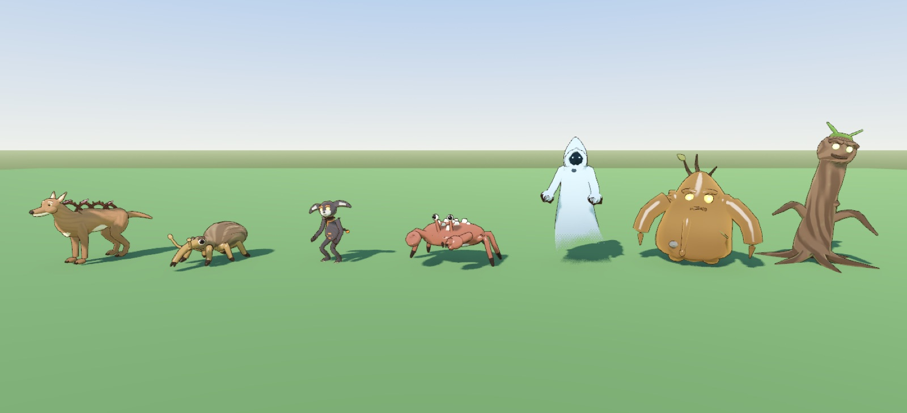
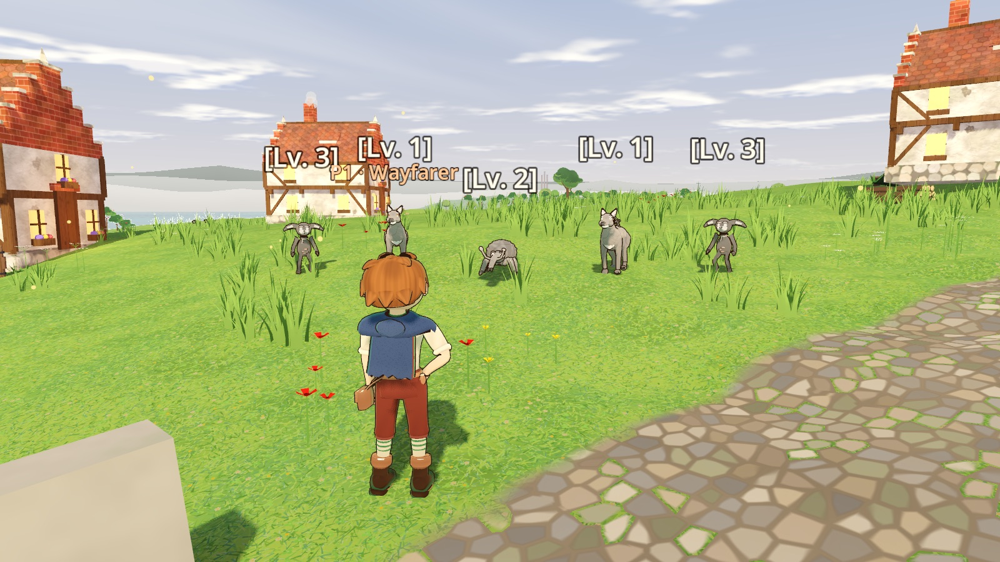
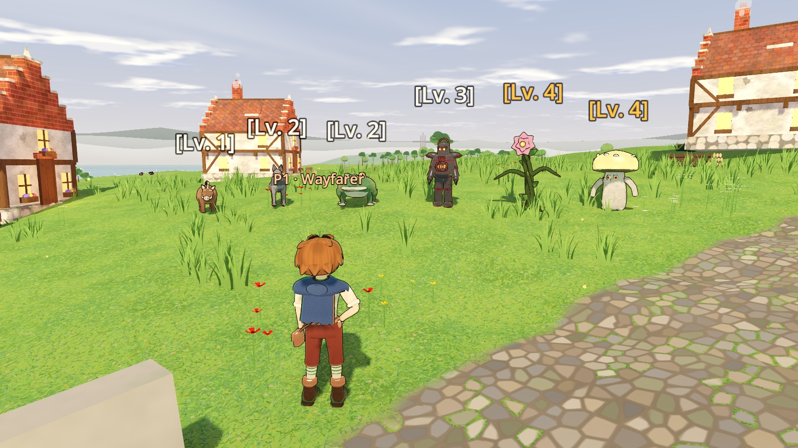

# 30_KIN_DESIGN_LANGUAGE.md — How Everwood's Kin Look and Move

> **Asked for (2026-11-09):** the Creative Director: overhaul the monsters a hero
> meets in their first five levels (their models, textures and animations) to
> match the character design language (docs/26) and to be built the same way as
> the heroes and the newest townsfolk.
>
> **Built (2026-11-09):** every foe body the hero meets on Embershore from Level
> 1 to 5, rebuilt on the heroes' own architecture: a skeleton built in code,
> sculpted lofts skinned to it, a painted material with the ink line, and a clip
> book the animator samples frame-locked to each blow. The shape-kit puppets
> (spheres and cones with two swinging leg sticks) are gone.

## 1. The one sentence

**Everwood's kin are spirits of a place made of its own stuff (hedge, bark,
plough-iron, sea-fret, sap), drawn with the people's ink line and painter's
hand: strange and grand at a distance, never gross, never cute, and readable at
a glance by one shape and one glow.**

It is docs/26's sentence for the people turned to the Lens's kin (docs/15 §1:
"never grotesque biological punching bags ... uncanny storybook majesty").

## 2. What the hero meets, Level 1 to 5

Act I's quests (docs/28, docs/29) and the packs along Embershore's roads
(`EmbershoreBuilder.ENCOUNTERS`): 26 kinds of kin in 10 bodies, worn as 20 looks.

| Level | Act I (Un-Inked) | Along the roads |
| :-- | :-- | :-- |
| 1 | Un-Inked Bramble-Hound (Q01) | Bristle-Hob, Thorn-Tail Hedgerow-Hob, Old Tusk-Hob |
| 2 | Grey-Bark Weevil and its Great-Boggart (Q02) | Grey Padfoot, Puddle-Bucca, Frost-Fang Padfoot |
| 3 | Ash-Grig; the Furrow Iron-Man and the Rusted Iron-Man (Q03) | Furrow Iron-Man, Clod-Flinger, Plough-Giant |
| 4 | Barnacle Scuttler, Tide-Wight (Q04) | Bramble-Lasher, Spore-Puff Lob, Bog-Hulk |
| 5 | Sap-Boggart and its Great-Boggart, Root-Lurker, the Blighted Taproot Stag (Q05) | Moss-Shield, Barrow-Rime and Barrow-Bell Spriggans |

## 3. Shape

- **Three reads from the 4.8 m camera:** the mass (long and low, round, tall,
  a mound), one signature (the hound's bramble hackles, the weevil's snout, the
  crab's claws, the Iron-Man's cauldron, the wight's hood, the lasher's rose,
  the stag's root antlers), and the eyes.
- **Made of their place** (docs/15 "Geological Texture"): hedge-thorn and
  dog-rose for the orchard's hounds, grey bark for the weevils, ash and a live
  coal for the granary's grigs, shell and barnacle for the quay's scuttlers,
  sea-fret and kelp for the wights, plough-iron for the furrow's Iron-Men,
  sap and root under the Elder Oak.
- **One continuous figure.** Lofted like the heroes: a body runs rump to head
  without a seam, legs bend at shoulder, elbow, hip, knee and hock, nothing
  floats. Dressings (canes, barnacles, moss, reeds) sit on the body and move
  with the bone under them.
- **Big where it reads.** Heads, paws, hands and feet a little big, as the
  heroes' 1.22x hands are.
- **Never gross.** No bared teeth, no gore, no slime. Mouths are small or a
  crack in the bark. A worn-down kin trembles; it never bleeds.

## 4. Eyes

Every kin has eyes, and they carry it, as the faces carry the people:

| | |
| :-- | :-- |
| Beasts and crawlers | Painted: a coloured iris, a dark pupil, one bright catchlight, a soft brow over each (hound, padfoot, bristle-hob, bucca, weevil, crab, thorn-tail, spore-lob) |
| Spirits | Glowing: the Ash-Grig's lamps, the Tide-Wight's lanterns in its hood, the Iron-Man's ember slits, the Root-Lurker's green, the Sap-Boggart's amber, the Taproot Stag's soft gold, the lasher's one gold eye in its rose |
| Every kin | Blinks every 3 to 6 s, quick, each on its own rhythm (`HeroMeshAtelier.blink_amount`, the people's own) |
| The Un-Inked | Blank paper with a pinprick of a pupil: "eyes as blank as paper" (docs/28 §2) |

## 5. Materials, and the Un-Inked

One material paints a whole kin (`storybook_kin_atelier.gdshader`), in the
heroes' painted light: the brush-stroke shade edge, the two-band cel ramp, the
turf bounce, the rim backlight, the 60-30-10 vertical gradient, and docs/26's
warm-umber ink line as its next pass.

| Material | Painted as |
| :-- | :-- |
| Fur | Strokes running along the body, darker roots, lighter tips, countershaded (darker on the back, paler under), a soft fuzz at the edge |
| Hide | Smooth and mottled, warts on a bucca, the belly paler and warmer, light warming through the terminator |
| Bark, moss | Deep fibrous ridges with lichen on the crests; moss in two greens with light flecks |
| Horn, thorn | Ivory with growth bands, darker at the root; bramble thorn red-brown with a bleached point |
| Shell, barnacle | Lacquered plates with a chipped pale rim; chalky cones with dark mouths |
| Plough-iron | Hammered and pitted, rust blooming out of the seams, brass worn bright; never chrome |
| Stone | Granite grain, lichen crusts on the tops |
| Cloth, sea-fret | Rags with a frayed dark hem; sea-fret cool and drifting, thinning to dithered wisps near the ground (and its ink line stops there too) |
| Sap, ember | Thick sap with its amber heart glowing at the edges; a live coal that flickers |
| Petals, leaves | A grey-green bud until it blooms pink; leaves with a midrib |

**The Un-Inked.** Act I's twelve kin (`MobVariantResource.un_inked`) walk
washed to paper grey with dried-paint cracks across them and blank eyes; their
values stay (a dark coat is a darker grey than a pale bib). Under the grey they
have true colours. Then the story plays on their bodies, on every peer:

- **Calmed** (`CalmingComponent`'s Recovery burst): the grey breaks up in ragged
  watercolour patches with a wet dark edge and is gone in 0.9 s; the hound's
  dog-roses open pink; the kin shakes itself like a wet dog, wags, holds a
  moment, then walks off as it fades (docs/28 §3.5).
- **Scattered** (burnt to nothing): it greys right through and its legs go.
- **A steward** (the Iron-Man turned right-way up): his colour comes back, he
  bows with a hand to his chest, and the brass Maker-Seal on his cauldron turns
  point-up (▲).

## 6. The same architecture as the heroes

| | Heroes and townsfolk | Kin |
| :-- | :-- | :-- |
| Skeleton | `HeroRigBuilder`: 24 bones, +Y along each bone | `KinRigBuilder` / `KinRig`: five families on the same rules (four legs 26 bones, six legs 27, stalks 12, mounds 13); two-legged kin wear the heroes' own 24 bones at their rest |
| Sculpt | `HeroMeshAtelier`: superellipse lofts on Catmull-Rom spines, up to 4 weights a ring, five surfaces | `KinSculptor` and its four families (`KinSculptBeasts`, `KinSculptCrawlers`, `KinSculptFolk`, `KinSculptGrowths`) on the same loft engine, one surface a look; the material in each vertex's colour as the heroes' are |
| Material | `storybook_hero_atelier.gdshader` + the ink line | `storybook_kin_atelier.gdshader` + the same ink line |
| Clips | `HeroClipBook` baked into one `AnimationLibrary`, sampled by phase | `KinClipBook` per family, baked onto each look's rest as its own `AnimationLibrary` ("kin_<look>"), sampled by phase |
| Animator | `HeroCombatAnimator`: frame-locked to the action, cross-fades | `KinAnimator`: the same rule, cross-fades and a layered flinch |
| Body node | `StorybookFigure` (townsfolk) | `KinFigure` |
| Drop-in model | `assets/models/heroes/<id>.glb` | `assets/models/<variant_id>.glb` still wins over a sculpt |

## 7. The looks

Each `MobVariantResource` names its look (`kin_look`); one that names none
wears its body's (`KinLooks.BODY_LOOKS`). Heights are the sculpt's; a figure is
scaled to its variant's height.

### 7.1 Four legs

| Look | Who | Shape and signature | Its blow |
| :-- | :-- | :-- | :-- |
| `hound` | Un-Inked Bramble-Hound | A lean, deep-chested hedge-hound: four bramble canes arching along its spine for hackles, thorned, budding dog-roses; a cream bib, big soft paws, hazel eyes | `attack_bite`: drawn back low on its haunches, the lunge, the snap |
| `padfoot` | Padfoots (Grey, Frost-Fang; the Crown's Gust and the Grey Squall) | Shaggier and heavier-pawed, a great ruff, a brush of a tail | `attack_bite` |
| `bristle_hob` | Bristle-Hob, Old Tusk-Hob | A barrel of a boar-hob: a bristle crest crown to back, a pink snout disc, upcurled tusks off the jaw (they carry the Sign), hooves | `attack_gore`: head down, the toss |
| `puddle_bucca` | Puddle-Bucca (the Crown's Sap-Sodden Bucca) | A broad toad-bucca, eyes up on its brow, a wide jaw that gapes, warty hide, a lily-leaf cap with a white flower | `attack_lunge`: squat, then spring |
| `taproot_stag` | The Blighted Taproot Stag | A stag as tall as a cottage: antlers of root and branch with moss tufts and hanging rootlets, a moss mantle over the withers, gold spirit eyes, and the rusted cuffs of Nokes's four chains on both forelegs and round its chest (docs/28 §7.4) | `attack_antlers`: reared and turned, the great sweep |
| `cairn_drake` | The Crag-Back Cairn-Drake (legacy maps) | A heavy drake under a shell of stacked, mossy crag; a brass bell on a rope at its throat | `attack_gore` |

### 7.2 Six legs

| Look | Who | Shape and signature | Its blow |
| :-- | :-- | :-- | :-- |
| `weevil` | Grey-Bark Weevil and its Great-Boggart | Domed bark wing-cases with a seam and ridged plates, a long curved snout with little jaws at its end, elbowed feelers with clubs, lichen in the bark | `attack_jab`: reared on its back legs, the snout down hard; `gnaw` at a tree |
| `barnacle` | Barnacle Scuttler | A broad crab-shell crusted with barnacles, a scalloped front rim, eyes on stalks, kelp over the edges, two great claws held up | `attack_snip`: both claws up and open, snapped shut ahead |
| `thorn_tail` | Thorn-Tail Hedgerow-Hob (the Crown's Cinder-Scuttler, Scree-Hob) | A round hedge-beetle in a coat of swept-back thorns, a pale little face and button nose, its thorny tail curled over its back with a white hedge-flower at the tip | `attack_tail`: drawn back, whipped over its head |

### 7.3 Two legs (the heroes' skeleton)

| Look | Who | Shape and signature | Its blow |
| :-- | :-- | :-- | :-- |
| `ash_grig` | Ash-Grig | A little soot-hob, 1.1 m: a big round head (grown 1.85x round the neck, as the youth's is), long drooping ears, lamp eyes, a pale ashen face and a small smile, a pot belly with a coal glowing through its cracks, a sacking scarf, three-toed feet, a tail with a coal at its tip. It stands in a crouch and scampers | `attack_throw`: an overhand cinder |
| `iron_man` | The Furrow Iron-Man, the Rusted Iron-Man, Furrow Iron-Men (the Crown's Clinker Iron-Men, Forge-Clad Sentinels) | Plough-iron round a cauldron chest: rust-bloomed hoops and rivets, a grate of coals (the Warmth-Ember) behind three bars, a bucket helm with ember eye-slits under a rivet brow and its handle over the top, plough-share shoulders, harrow-tine fingers, stove-pipe legs on plough-share boots, furrow moss in its seams, and the brass Maker-Seal plate that turns | `attack_slam`: both fists overhead, down with its weight |
| `iron_flinger` | Clod-Flinger Iron-Man | A slighter cauldron, thinner arms, long rake-tine hands | `attack_throw` |
| `iron_giant` | Plough-Giant Iron-Man | A bigger cauldron and a plough-blade on its left arm | `attack_slam` |
| `tide_wight` | Tide-Wight (the Crown's Scribe-Wights, Storm-Caller Vaelen) | Sea-fret in a hooded shape: a deep cowl, its opening dark, lantern eyes, barnacles on its edge, a shell brooch, kelp from the shoulders, long thin arms in dagged sleeves, pale cold hands; a robe that thins to wisps above the ground, no feet. It floats | `attack_sweep`: a cold arm swept across |
| `spriggan` | Moss-Shield, Barrow-Rime and Barrow-Bell Spriggans | A squat stone-guard: a boulder of a body, a stone face with glowing eyes, a moss cloak, boulder fists, a round stone shield with a moss rim and brass boss, a little brass bell at its belt | `attack_slam` |
| `bog_hulk` | Bog-Hulk Boggart (the Crown's Colossus, Siphon-Prelate, Old Bellows) | A hunched peat-and-moss giant: vast shoulders, a small bark head low between them with bog-light eyes, peat showing through the moss, long arms to bark-knuckled fists, bulrushes up its back, roots hanging | `attack_slam` |

### 7.4 Stalks and mounds

| Look | Who | Shape and signature | Its blow |
| :-- | :-- | :-- | :-- |
| `root_lurker` | Root-Lurker | A knotted root reared out of the wall in an S, roots spreading over the ground from its foot, a great knot for a head with a bark brow, two green eyes, a crack of a mouth, leaves sprouting from moss; two root-whips | `attack_lash`: reared back, whips raised, thrown forward and cracked down |
| `bramble_lasher` | Bramble-Lasher Hob (the Crown's Blight-Lasher) | Three bramble canes twisted up together, thorned and leafing, under a great wild rose with one gold eye in its heart; two thorny whips | `attack_lash` |
| `sap_boggart` | Sap-Boggart and its Great-Boggart (the Crown's Mother Sluice) | A slumped mound of thick sap with an amber heart, twigs, leaves and a pebble swallowed in it, amber eyes under a heavy brow, a slow sad mouth, stubby arms whose mitts drip, a drip down its front | `attack_slap`: drawn up and back, down across with all its weight |
| `spore_lob` | Spore-Puff Lob | A stout pale mushroom-lob under a spotted puffball cap with dark gills, a round little face | `attack_puff`: squashed down, then up and out |

## 8. Motion

- **Always alive.** Breathing, a glance, an ear flick, a tail or a robe
  swaying, feelers twitching, a blink.
- **Every family** has `idle`, `walk`, `run`, `hit`, `stagger`, `kneel`,
  `waver`, `collapse`, `calmed` and `happy`, and each look its own blow; the
  two-legged add `bow`; weevils `gnaw`; the big kin `roar`. The Ash-Grig
  crouches and scampers, the Bog-Hulk hunches, the Tide-Wight floats.
- **The telegraph is the pose.** A blow's clip is frame-locked like the
  heroes': its wind-up frames are stretched onto the action's wind-up, its
  strike onto the active frames, the rest onto the recovery. The part that
  strikes (a jaw, tusks, a snout, claws, fists, a whip, a cap) carries the
  Sign vein and glows in the blow's Sign through the wind-up, beside
  ActorBase's aura shell, so a Tank reads which Ward-Mantle soaks it.
- **Gaits keep to the ground.** A walk or run cycle advances with the ground
  covered (the look's stride length), so paws never skate; the run takes over
  at 62% of the kin's speed. Another peer's copy walks from how far it moved.
- **The story's states win in order:** a steward's bow; a calm; downed (the
  scatter's collapse); its posture broken (kneels, swaying); a stagger; a blow;
  worn down (wavers, trembling, head low, ears flat, tail tucked, between its
  blows); a Challenge-Roar; a soothed hob's dance; a weevil at its tree; the
  gait; the idle. A blow that lands flinches it over whatever it's doing.
- **Cheap at a distance.** A kin within 24 m of a hero poses every frame,
  20 times a second to 55 m, 6 to 110 m, once a second beyond. Posing costs
  about 0.02 ms a kin; a look is sculpted (5 to 20 ms) and baked once, when a
  spawner of it is built, never in the frame a kin steps out.

## 9. Checks

`tools/test_kin_atelier.gd` runs inside the Caldera checks right after Act I (so
in the smoke test and `tools/run_caldera_checks.gd`), seven checks:

1. Every look sculpts one skinned surface on its own skeleton (four weights a
   vertex, every bone real), standing on its feet at its height, under 7,000
   vertices, identical kin sharing one mesh.
2. Every kin wears a look: Act I's twelve their own and Un-Inked, the 37 foes in
   Embershore's road packs and every other kin a look.
3. Every family's clips on every look, blows winding up before they strike,
   gaits and collapses that move.
4. A figure's material, ink line (the wight's hem unlined), fit, striking limbs
   and seal plate; the calm's wash and bloom, the scatter's grey, a steward's
   colour, a flinch.
5. Live on Embershore: a hound, a scuttler and a Tide-Wight stand as figures,
   the Sign-carrying limbs registered.
6. A hurt hound runs on its gait; its bite frame-locked (wind-up frames through
   the wind-up, the strike's as it lands); its posture broken it kneels; a
   worn-down scuttler wavers between its blows.
7. A calmed hound's grey washes off as its calm plays, it holds, then walks
   off as it fades; a Tide-Wight burnt to nothing greys through and crumbles.

The Lens checks' steward Iron-Man now checks his figure's colour back and his
seal plate turned (a dropped-in model would still lean by `STEWARD_BOW`).

## 10. Build notes

**What was built (2026-11-09)**

- `src/actors/kin/`: `KinRig`, `KinRigBuilder`, `KinLooks`, `KinSculptor`,
  `KinSculptBeasts`, `KinSculptCrawlers`, `KinSculptFolk`, `KinSculptGrowths`,
  `KinClipBook`, `KinAnimator`, `KinFigure`.
- `src/actors/shaders/storybook_kin_atelier.gdshader`; the ink line
  (`storybook_ink_outline.gdshader`) gained `mist_cut` (off, -1, for everyone
  but sea-fret kin).
- `WildMob` builds a `KinFigure` (unless a .glb is dropped in), registers its
  striking limbs, poses it on every peer, holds a calmed kin's fade until its
  calm has played, and walks it off as it fades. Its shape-kit bodies and stick
  legs are gone. `ActorBase._poses_itself()` keeps the greybox lean off a kin.
- `CalmingComponent`'s burst tells the kin (`WildMob.on_calm_burst`).
- `MobVariantResource.kin_look` and `un_inked`; the Bestiary dresses each kin
  and gives Act I's twelve their true colours under the grey.
- `MobSpawner` warms its kin's looks as it's built (`KinFigure.warm`).

**Deliberate differences**

1. **No springs.** The heroes' `StorybookKinematicsModifier3D` isn't on kin:
   tails, ears, robes and whips move by their clips. No foot IK either, so on a
   slope a paw can sit a little above or into the ground.
2. **No expression rig.** As docs/26: a jaw opens and eyes blink; faces don't
   change expression.
3. **The Maker-Seal** is now a brass plate on the Iron-Man's chest that turns;
   the floating ▼ / ▲ label stays for reading it from across a fight.
4. **Two-legged kin share the heroes' rest.** Their own proportions come from
   the sculpt (a big head warped round the neck, a cauldron round the spine),
   so hero poses fit them unchanged.

## 11. Calls for the Creative Director

1. **The Crown's Level 13 to 14 kin wear these looks too**, since they share
   the ten bodies (an Iron-Man for the Forge-Clad Sentinels, a Bog-Hulk for the
   Anvil-Warden Colossus, a Tide-Wight for Storm-Caller Vaelen). *Default: keep
   until The Crown's kin get their own looks.*
2. **Act I's true colours** (a fawn-russet hound, a chestnut weevil, a red-brown
   crab, a red-deer stag) are invented here; docs/28 only says what's grey.
   *Default: keep; change freely in `Bestiary._add_act_one_kin`.*
3. **Act I's kin are grey from the start**, everywhere, not only at the
   orchard's grey perimeter (docs/28 §3: "They aren't wicked. They're blank").
   *Default: keep.*
4. **A calmed kin walks off as it fades** (docs/28: the hound "trots into the
   hedge"); it walks the way it faces, not to a hedge. *Default: keep.*
